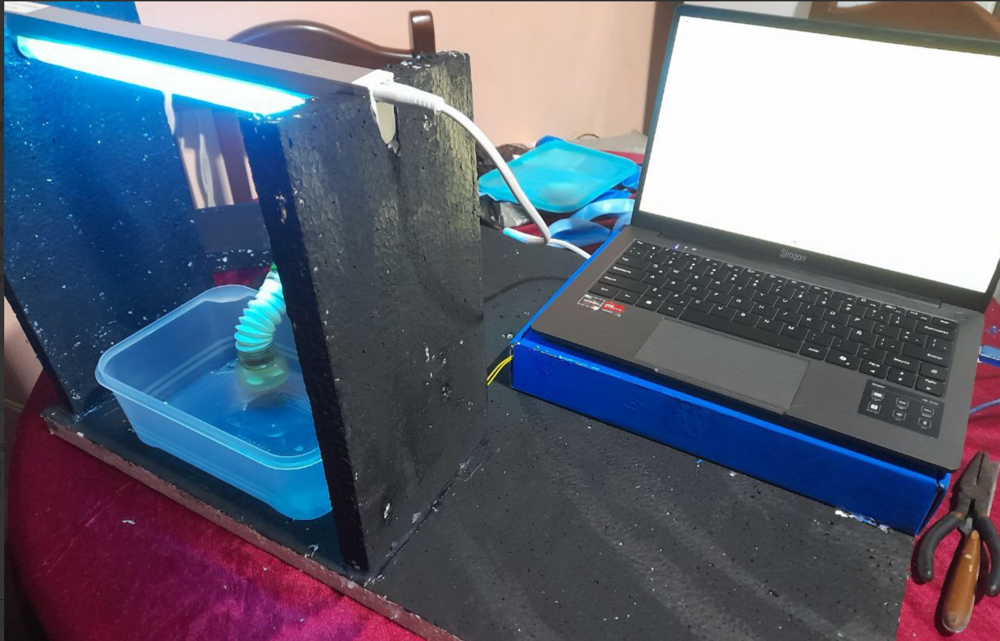

# Aguabot: prototipo de purificación de agua con luz UV-C

Proyecto individual de la materia **Programación II** (UNET, agosto de 2025), presentado en la exposición de proyectos de la materia, por **Kimberly Zapata**. Las pruebas de laboratorio con microscopio se realizaron en el laboratorio del Complejo Educativo Simón Candiales, con apoyo de una profesora. Es un prototipo de bajo costo que combina un filtro tradicional, desinfección con luz ultravioleta (UV-C) y un control con Arduino que se maneja desde una laptop.



## Idea

Muchas comunidades tienen acceso limitado a agua potable. Aguabot propone un sistema en tres etapas:

1. **Filtrado mecánico** con malla (retiene partículas grandes).
2. **Filtrado químico** con carbón activado.
3. **Desinfección con luz UV-C**, que se enciende automáticamente cuando el tanque inferior está lleno.

El diseño completo, con el esquema, el fundamento científico y las pruebas, está en [`docs/Aguabot_justificacion_y_pruebas.pdf`](docs/Aguabot_justificacion_y_pruebas.pdf).

## Qué se construyó

- Estructura casera con dos recipientes (superior e inferior).
- Filtro tradicional.
- Lámpara UV-C controlada con un **relé**.
- **Sensor de nivel tipo flotador** que detecta si el tanque está lleno.
- **Arduino** que controla el relé y se comunica con la laptop por USB.
- Programa en **Python** (interfaz de escritorio) para encender, apagar, pasar a modo automático y ver los mensajes del sistema.

## Cómo funciona

El código del Arduino (`arduino/aguabot.ino`) tiene dos modos:

- **Automático:** si el flotador indica tanque lleno, enciende la lámpara; si está vacío, la apaga.
- **Manual (desde la laptop):** `1` enciende la lámpara por 5 minutos, `0` la apaga y `A` vuelve al modo automático.

El programa de Python (`python/control_lampara.py`) usa `pyserial` para enviar esos comandos y mostrar lo que responde el Arduino. La interfaz usa Tkinter con ttkbootstrap.

## Pruebas realizadas

Se hizo una prueba preliminar de laboratorio con un microscopio óptico (aumentos de 10x y 16x): se observaron bacterias y protozoarios en agua sin tratar y, tras exponerla al sistema UV-C, se observó una reducción notable. Las fotos y los videos están en el documento.

**Limitaciones de la prueba:** es una observación cualitativa con un microscopio de baja resolución. No reemplaza un análisis microbiológico formal, así que no permite afirmar que el agua quede apta para el consumo humano.

## Lo que quedó pendiente (honestidad técnica)

- El **sensor de pH** y la **app móvil Bluetooth** aparecen en el diseño, pero **no se implementaron**. La app en Kotlin se intentó y falló, por lo que se cambió a una interfaz en Python con cable USB.
- El **tiempo de exposición de 40 minutos** del diseño no está programado en el código: el modo automático mantiene la lámpara encendida mientras el tanque está lleno.
- Al enviar `0` (apagado manual) el sistema vuelve a automático, así que si el tanque sigue lleno, la lámpara se vuelve a encender en el siguiente ciclo.
- El programa de Python se desarrolló **con apoyo de herramientas de IA**, y yo lo estoy estudiando para entenderlo y mejorarlo.

## Seguridad

La luz UV-C es dañina para ojos y piel. La lámpara debe estar dentro de un compartimento cerrado y nunca se debe mirar ni exponer las manos mientras está encendida.

## Estructura del repositorio

```
aguabot/
├── arduino/aguabot.ino          # control del relé y el sensor de nivel
├── python/control_lampara.py    # interfaz de escritorio (pyserial)
├── docs/Aguabot_justificacion_y_pruebas.pdf
└── imagenes/prototipo.png
```

## Cómo probarlo

1. Cargar `arduino/aguabot.ino` al Arduino (sensor de nivel en el pin 2, relé en el pin 8).
2. Instalar las dependencias de Python: `pip install pyserial ttkbootstrap`
3. Ejecutar `python python/control_lampara.py`, elegir el puerto COM y conectar.

## Autora

Kimberly Zapata · estudiante de Ingeniería en Informática (UNET) · GitHub: [carolizap12](https://github.com/carolizap12)
